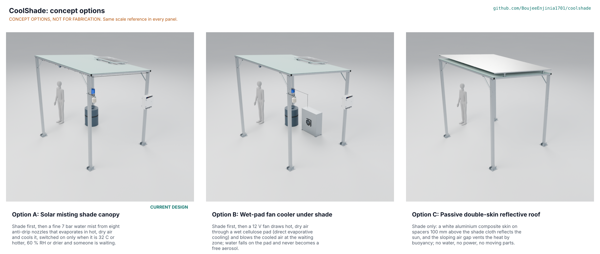

# CoolShade concept options

Result: the weighted score puts option C, the passive double-skin roof, first with 159 of 190, ahead of option B, the wet-pad fan cooler, with 135 and option A, the solar misting shade canopy, with 134. **Option C does not cool the air at all** (UR-002, a High need, scores 1), so it is a better shade, not a cooling product. Options A and B are within 10 % of each other (134 and 135), so both go to Amish. The current design, A, does not change, and the choice is **Proposed, awaiting Amish** (CSH-DDR-004). All three options are modelled to detail level D3 in `cad/src/model.py` ("Detail every option", Amish, 2026-10-24); the picture below is redrawn from those models by the coordinator's Blender run. Method: STANDARDS section 21.

## The options

### Option A: solar misting shade canopy (the current design)

Four galvanised posts carry a 3.0 x 2.4 m mono-pitch roof with removable shade cloth. A 12 V diaphragm pump drives water from a 120 L tank at 7 bar through a loop of misting line to eight anti-drip nozzles. The 0.4 mm jets make a fine mist that evaporates in hot, dry air and cools it by 2.7 °C while spraying (CSH-CAL-001 E2). A microcontroller mists only when the air is 32 °C or hotter, 60 % humidity or drier, someone is waiting and the tank is not low. A 100 W panel and a 25 Ah LiFePO4 battery make it energy neutral on the design day. Everything is bolted, no welding. Risks: wetting if the droplets are too big (STEM S4), *Legionella* in warm tank water (S14), scale in the nozzles (S12), the cost, USD 882 against the USD 775 target.

### Option B: wet-pad fan cooler under shade

The same posts, roof and shade cloth, but no mist. A welded 25 mm steel cabinet at the rear holds a 90 mm cellulose wet pad in its rear opening and a 12 V axial fan in its front panel. A small pump trickles tank water over the pad once through (no sump, no free aerosol); the fan draws hot, dry air through the wet pad, which leaves at about 26 °C from 38 °C air (STEM S22), and blows it at the waiting zone. Direct evaporative cooling is a standard technology. Risks: the cooled stream is about 1.5 kW, 8 % of option A's mist, so it cools one or two people, not a group (S24); a wet pad is still a place where bacteria grow; the cabinet is welded, which a community workshop may not do; pad replacement.

### Option C: passive double-skin reflective roof

The same posts, roof and shade cloth, but no water and no power. Eight welded spacers on the end beams and purlins carry four rails 100 mm above the cloth, and three 3 mm white aluminium composite sheets on the rails reflect the sun. The sloping air gap vents the heat by buoyancy (S25). Nothing moves and nothing needs refilling. Risks: it cools no air, so it is a better shade and not a cooling product; the skin cannot be taken off before a storm, so the frame must carry 30 m/s with the roof solid (S26), and the anchors need a site check; the wind makes the skin noisy.

## First-order numbers

Table 1. Options compared (D3 model figures from `cad/fidelity.json`; the model overstates the mass of the fabric and the panel, CSH-CAL-001 v0.6).

| Quantity | Option A | Option B | Option C |
| --- | --- | --- | --- |
| Estimated parts cost (USD) | 882 (priced BOM, TRL 3) | More than 809: A's lines 1 to 11, 13, 15 and 16 stay, line 12 and the drain valve go; fan, pad and cabinet to assess | 355 for A's lines 1 to 4 and 16 that stay, plus three composite sheets and spacers, to assess |
| Mass of the D3 model (kg) | 233.5 | 290.5 | 259.0 |
| Parts in the D3 model (with fasteners and welds) | 372 (284 fasteners, no welds) | 472 (344 fasteners, 20 welds) | 432 (352 fasteners, 16 welds) |
| Moving parts | 2 (pump, drain valve) | 2 (fan, pump) | 0 |
| Cooling of the air | 2.7 °C while spraying, 18.8 kW absorbed | About 12 K colder air from a 1.5 kW stream, one or two people | None |
| Water per design day (L) | 85 | About 11 (2.2 L/h for 5 h) | 0 |
| Power on the design day (Wh) | 204 | Fan about 35 W plus pump, to assess | 0 |
| STEM check | 8 within, 13 plausible (CSH-STM-001) | Within in principle, reach plausible | Within in principle, anchors to assess |

## Scoring

Table 2. Weighted scoring against the user requirements (weights: High need 3, Medium 2; scores 1 to 5, 5 best; maximum 190).

| Criterion | Source | Weight | A | B | C | Reason |
| --- | --- | --- | --- | --- | --- | --- |
| Shade from the sun | UR-001 | 3 | 4 | 4 | 5 | C adds a white skin over the cloth; B's cabinet takes some of the rear zone |
| Cooler air | UR-002 | 3 | 4 | 3 | 1 | A cools a group by 2.7 °C; B reaches one or two people; C cools nothing |
| I stay dry | UR-003 | 3 | 2 | 4 | 5 | A's droplets are not yet shown to evaporate (S4); B wets only the pad |
| Room for everyone | UR-004 | 3 | 4 | 3 | 4 | B's cabinet and fan guard use the rear of the zone |
| Works only when needed | UR-005 | 2 | 5 | 4 | 4 | A and B switch on temperature, humidity and presence; C is passive |
| No power connection | UR-006 | 3 | 4 | 4 | 5 | C needs no power; A and B run on the panel and battery |
| Safe water | UR-007 | 3 | 2 | 3 | 5 | A makes an aerosol from 34 °C tank water (S14); B has no free aerosol |
| Stands up to wind and weather | UR-008 | 3 | 4 | 4 | 3 | C's skin stays on in a gust (S26) |
| Safe electrics | UR-009 | 3 | 4 | 4 | 5 | 12 V, fused, in A and B; none in C |
| Privacy | UR-010 | 2 | 4 | 4 | 5 | A and B carry a PIR sensor; C none |
| Easy to keep running | UR-011 | 2 | 2 | 3 | 5 | A: nozzles scale, daily drain; B: pad changes; C: wash the skin |
| The community can build it | UR-012 | 2 | 4 | 2 | 3 | A is bolted; B's cabinet and C's spacers are welded |
| It can be moved | UR-013 | 2 | 4 | 3 | 3 | Model masses 233 / 291 / 259 kg; two people carry the pieces |
| Affordable | UR-014 | 2 | 3 | 3 | 5 | A is over the target; C keeps only the frame and cloth lines |
| Uses little water | UR-015 | 2 | 3 | 5 | 5 | 85 L, about 11 L and none per design day |
| **Weighted total** | | | **134** | **135** | **159** | |

Weighted total = sum of score x weight over the 15 needs (maximum 190). The scores are the author's judgement from the numbers above and the STEM check, to be reviewed with a co-design partner.

## Recommendation (Proposed, awaiting Amish)

Options A and B are within 10 % of each other (134 and 135), so both go to Amish without a pick between them. Option C scores highest (159) but cannot be the product Amish pitched: it fails the High need for cooler air (UR-002 scores 1) and the score only rewards that it asks nothing of the user. The recommendation is therefore:

1. **Keep option A as the design.** It is the only option that meets UR-002 for a group, it is the pitch, and the unmet needs (UR-003 wetting, UR-007 water safety) are the ones the maker's data and a hygiene plan can still close. Nothing in the design changes.
2. **Treat option C's white skin as an add-on to A**, to assess: the skin is the part of C that improves shade, and it would cost the removable cloth's advantage in a gust. Not modelled or priced; a possible hybrid for Amish.
3. **Keep option B as the fallback** if the nozzle's droplets prove too big (S4) or the hygiene plan fails (S14): it has no free aerosol, but it reaches only one or two people, so the group cooling of UR-002 would be lost.

Decision needed from Amish: confirm option A, or choose B or C, or ask for the hybrid (CSH-DDR-004, CSH-DEC-001 D8). Until then `concept_chosen` is "A (proposed)".
